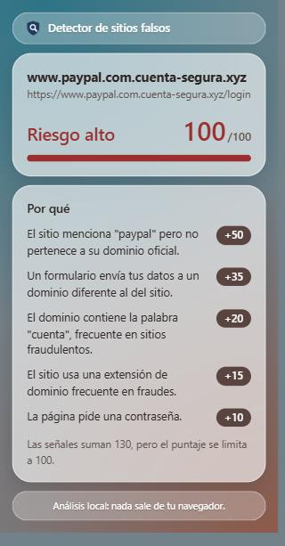

# Detector de sitios falsos

Extensión de navegador (Chrome / Edge) que analiza la pestaña actual y calcula un **puntaje de riesgo** para ayudar a detectar sitios de phishing, clones de marcas y dominios fraudulentos.

> 🚧 Proyecto en desarrollo activo. Se construye por etapas, priorizando entender cada concepto antes de agregar el siguiente.

<p align="center">
  
  <br />
  <sub>Ejemplo con un sitio de prueba que suplanta a PayPal.</sub>
</p>

## ¿Cómo funciona?

Un sitio falso rara vez se delata con una sola señal. El detector **suma señales sospechosas** de la dirección y del contenido de la página, cada una con un peso, y devuelve un puntaje de 0 a 100 junto con los motivos.

```
Pestaña activa
  ├─► URL ─────────► Analizador de URL ───────┐
  └─► Recolector ──► Analizador de página ────┤
                                              └─► Puntaje + motivos ─► Popup
```

- **Recolector** (`src/content/`): se inyecta en la página solo cuando el usuario hace clic en el ícono y cuenta campos de contraseña, campos de tarjeta y destinos de formularios. No toma decisiones.
- **Analizadores** (`src/core/`): funciones puras que deciden qué es sospechoso. No dependen de React ni de las APIs del navegador, por lo que se prueban de forma aislada con tests unitarios.

## Señales de la URL

| Señal                                     | Peso | Ejemplo                                                          |
| ----------------------------------------- | ---- | ---------------------------------------------------------------- |
| Sin HTTPS                                 | 10   | `http://ejemplo.com`                                             |
| Hosting gratuito                          | 15   | `mi-tienda.vercel.app`, `usuario.github.io`                      |
| Extensión de dominio de riesgo (TLD)      | 15   | `ofertas.xyz`, `promo.top`                                       |
| Exceso de guiones en el dominio           | 15   | `tienda-de-ofertas-online.com`                                   |
| Palabras gancho en el dominio             | 20   | `secure-login-banco.com`, `cuenta-segura.com`                    |
| Punycode (caracteres de otro alfabeto)    | 25   | `аpple.com` (con "а" cirílica)                                   |
| Dirección IP en lugar de dominio          | 30   | `http://192.168.1.10/login`                                      |
| Destino oculto con `@`                    | 35   | `https://www.paypal.com@cuenta-segura.xyz`                       |
| Typosquatting (dominio mal escrito)       | 40   | `paypa1.com`, `bancopichlncha.com`, `amaz0n.com`                 |
| Suplantación de marca en un dominio ajeno | 50   | `www.paypal.com.cuenta-segura.xyz`, `pichincha-banca-segura.com` |

### Marcas protegidas

Las reglas de suplantación y typosquatting reconocen 13 marcas, definidas en `src/core/brands.ts`:

- **Servicios globales:** PayPal, Google, Facebook, Instagram, WhatsApp, Microsoft, Amazon, Netflix y Mercado Libre.
- **Bancos de Ecuador:** Banco Pichincha, Banco Guayaquil, Produbanco y Banco del Pacífico.

Cada marca tiene sus palabras clave y sus dominios oficiales. Los dominios de los bancos se verificaron uno por uno, porque un dominio oficial faltante haría que el sitio real del banco se marque como riesgo.

### Precisión medida

La extensión se evaluó con 14 URLs reales y falsas. Los casos clave quedaron incorporados a los tests para evitar regresiones:

| Versión | Sitios falsos detectados | Falsos positivos en sitios legítimos |
| ------- | ------------------------ | ------------------------------------ |
| v1.0    | 2 de 8                   | 1 (`accounts.google.com`)            |
| v1.1    | 8 de 8                   | 0                                    |

## Señales del contenido de la página

| Señal                               | Peso | Qué detecta                                                           |
| ----------------------------------- | ---- | --------------------------------------------------------------------- |
| Campo de contraseña                 | 10   | Un `<input type="password">`                                          |
| Campo de tarjeta                    | 20   | Inputs con `autocomplete="cc-number"` o "card"/"tarjeta" en el nombre |
| Formulario que envía a otro dominio | 35   | Un `<form>` cuyo `action` apunta a un dominio distinto al del sitio   |

El campo de contraseña pesa poco por sí solo, porque todo login legítimo lo tiene. Su valor está en sumarse a una URL sospechosa.

## Insignia de riesgo

Un service worker analiza la URL de cada pestaña en segundo plano y muestra el puntaje sobre el ícono de la extensión, sin necesidad de abrir el popup. Cada pestaña tiene su propia insignia.

| Puntaje  | Insignia     |
| -------- | ------------ |
| 0        | Sin insignia |
| 1 a 29   | 🟡 Amarillo  |
| 30 a 59  | 🟠 Naranja   |
| 60 o más | 🔴 Rojo      |

La insignia refleja solo el análisis de la URL. El popup muestra el análisis completo, que además incluye el contenido de la página, por lo que su puntaje puede ser mayor.

## Privacidad y permisos

Todo el análisis se hace **localmente**: ninguna URL ni dato de la página sale del navegador.

| Permiso     | Para qué se usa                                                          |
| ----------- | ------------------------------------------------------------------------ |
| `tabs`      | Leer la URL de cada pestaña para actualizar la insignia automáticamente  |
| `activeTab` | Acceder a la pestaña actual solo cuando el usuario hace clic en el ícono |
| `scripting` | Inyectar el recolector en esa pestaña para analizar su contenido         |

Se descartó pedir acceso a todos los sitios (`<all_urls>`) para analizar el contenido de forma automática: para una herramienta de seguridad, solicitar el permiso más amplio de todos sería contradictorio.

### Detalles técnicos

- **Dominio registrado:** se obtiene con [`tldts`](https://github.com/remusao/tldts), que usa la Public Suffix List. Así, `checkout.paypal.com` se reconoce como legítimo y `paypal.com.cuenta-segura.xyz` no.
- **Hosting gratuito:** se aprovecha que `tldts`, por defecto, trata dominios como `vercel.app` o `github.io` como el dominio registrado.
- **Typosquatting:** se normalizan los homoglifos (`0 → o`, `1 → l`, `rn → m`, etc.) y luego se mide la [distancia de Levenshtein](https://es.wikipedia.org/wiki/Distancia_de_Levenshtein) contra las marcas conocidas. El umbral depende del largo: 1 letra de diferencia para marcas de hasta 6 letras y 2 para las más largas, así "amazonas" no se confunde con "amazon".
- **Suplantación de marca:** el dominio se divide en palabras (por puntos y guiones) y la marca tiene que aparecer como palabra completa. Las reglas de marca no se aplican a sufijos de registro restringido, como `.gob.ec` o `.edu.ec`, que solo pueden obtener entidades verificadas.
- **Destino oculto con `@`:** el parser de URL interpreta todo lo que está antes del `@` como usuario, así que basta con revisar si la URL trae uno.
- **Palabras gancho:** se buscan solo en el dominio, no en la ruta, porque casi todos los sitios legítimos tienen rutas como `/login`. Se comparan por raíz (`segur` cubre seguro, segura y seguridad) y no se aplican a los dominios oficiales de las marcas conocidas.
- **Punycode:** el parser de URL convierte los caracteres no latinos al formato `xn--`, que es lo que se detecta. Al contar guiones, ese prefijo se descarta.
- **Formularios a otro dominio:** se compara el dominio registrado del `action` con el de la página, así un banco que envía su login a `auth.banco.com` desde `www.banco.com` no se marca.
- **Inyección bajo demanda:** el recolector se ejecuta con `chrome.scripting.executeScript` en lugar de un content script permanente, así que no lee el contenido de ninguna página hasta que el usuario hace clic.
- **Service worker:** escucha `chrome.tabs.onUpdated` y reutiliza el mismo `analyzeUrl` del popup. Vite lo compila como una entrada aparte con nombre fijo (`background.js`), porque el manifest no admite nombres con hash.

## Stack

- TypeScript + React
- Vite
- Manifest V3
- Vitest
- ESLint + Prettier

## Instalación

```bash
npm install
npm run build
```

Luego, en el navegador:

1. Abrir `chrome://extensions` (o `edge://extensions`).
2. Activar el **Modo desarrollador**.
3. Hacer clic en **Cargar descomprimida** y seleccionar la carpeta `dist`.

## Scripts

```bash
npm test         # Ejecuta los tests en modo observación
npm run lint     # Revisa el código con ESLint
npm run format   # Formatea el código con Prettier
```

Para regenerar los íconos de la extensión (escudo con lupa) en sus cuatro tamaños:

```bash
powershell -ExecutionPolicy Bypass -File scripts/generate-icons.ps1
```

## Diseño del popup

- **Veredicto primero:** el nivel de riesgo y el puntaje se leen de un vistazo, con una barra que se llena con el color del nivel.
- **La cuenta a la vista:** cada señal muestra cuánto sumó al puntaje, ordenadas de mayor a menor peso. Si la suma supera 100, el popup lo aclara.
- **Estilo sobrio:** paneles de vidrio esmerilado sobre un fondo difuminado, con tonos apagados. La insignia del ícono conserva colores vivos para destacar en la barra del navegador.
- **Contenedor / presentacional:** `App.tsx` obtiene los datos de la pestaña y `RiskReport.tsx` solo los muestra.

## Estructura

```
docs/
  popup.png              # Captura para este README
public/
  manifest.json          # Configuración de la extensión
  icons/                 # Íconos PNG generados por el script
scripts/
  generate-icons.ps1     # Dibuja los íconos de la extensión
src/
  components/
    RiskReport.tsx       # Presentación del análisis en el popup
  content/               # Código que se ejecuta dentro de la página analizada
    collect-page-facts.ts
  core/                  # Lógica de detección (pura, sin dependencias del navegador)
    url-analyzer.ts      # Señales de la URL
    brands.ts            # Marcas conocidas y sus dominios oficiales
    page-analyzer.ts     # Señales del contenido de la página
    score.ts             # Cálculo del puntaje final
    badge.ts             # Texto y color de la insignia
    levenshtein.ts
    *.test.ts
  App.tsx                # Popup: obtiene los datos de la pestaña
  background.ts          # Service worker que actualiza la insignia
```

## Hoja de ruta

- [x] Popup que muestra la URL de la pestaña activa
- [x] Analizador de URL con puntaje y motivos
- [x] Señales de hosting gratuito y TLDs de riesgo
- [x] Señales de palabras gancho, punycode, `@` en la URL y exceso de guiones
- [x] Análisis del contenido de la página (contraseñas, tarjetas, formularios a otro dominio)
- [x] Service worker con indicador de riesgo en el ícono
- [x] Pulido: ícono propio, diseño del popup y limpieza de la plantilla
- [x] v1.1: bancos de Ecuador, coincidencia por palabra completa y menos falsos positivos
- [ ] Backend para consultas de WHOIS, certificados SSL y listas negras
- [ ] Modelo de machine learning

## Limitaciones conocidas

- La lista de marcas es limitada: una marca que no está en `brands.ts` no se protege contra suplantación ni typosquatting.
- Algunas marcas tienen más dominios oficiales que los registrados; un dominio oficial faltante se marcaría como riesgo.
- Algunas URLs pueden activar varias señales relacionadas a la vez, lo que infla el puntaje.
- Las palabras gancho por raíz pueden marcar sitios legítimos, por ejemplo una aseguradora cuyo dominio contiene "seguros".
- El punycode también se activa con dominios legítimos con ñ o tildes, como `españa.com`.
- La detección de campos de tarjeta se basa en nombres de atributos, por lo que un sitio puede evitarla usando nombres genéricos.
- El navegador no permite inyectar el recolector en algunas páginas, como la Chrome Web Store. En esos casos solo se analiza la URL.

## Autor

Desarrollado por **Bryan Gallardo**.
